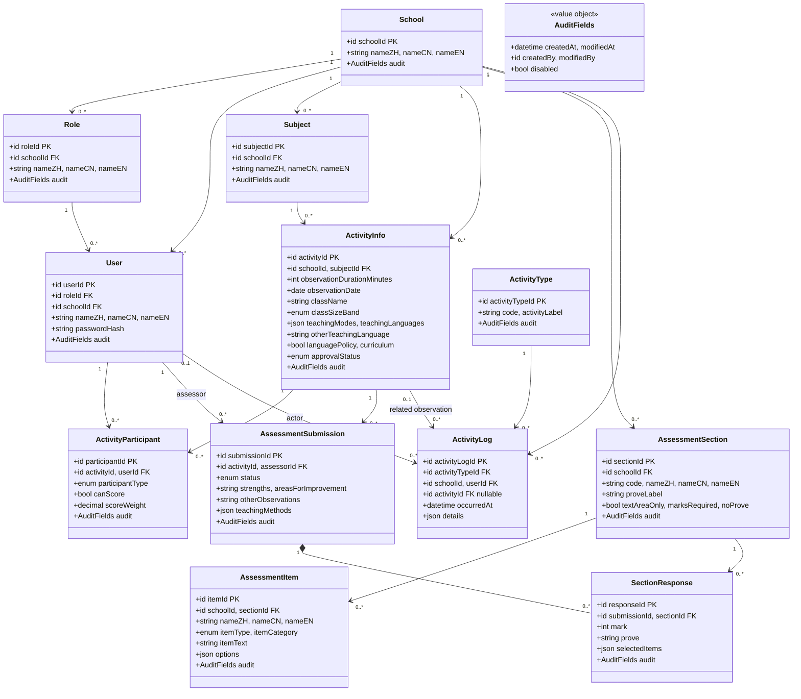

# Lesson observation: proposed UML class diagram

This is a proposed data model, not an implementation or a statement that these tables already exist. `ActivityLog` is entirely new. `ActivityType` categorizes audit events; it is not the lesson observation itself. PK and FK indicate database keys. All relationships and additions described below need confirmation.



`AuditFields` is shorthand for columns on each applicable table, not a required separate table. `createdBy` and `modifiedBy` reference `User`; system actions and initial school/user creation may need nullable values. The log records events rather than using the mutable audit fields. The diagram assumes one account has one school role; an observation-specific participation type is independent of that role.

## Saving marks and form responses

Create one `AssessmentSubmission` per scoring assessor per activity, with one `SectionResponse` per section. Seed sections B1–B13 as school-specific definitions. `mark` is nullable in drafts and otherwise an integer 1–4 when required. Store evidence in `prove` when a section has its own evidence; however, some evidence boxes in the source form cover several B sections. Preserve each shared box once in a separate response for a non-scored section, or define an explicit shared evidence grouping; do not duplicate or silently merge evidence. Text-only sections can hold the form's other narrative responses. The separate submission fields shown above are a proposed convenience and should not be duplicated in text-only sections.

`selectedItems` is a JSON array using stable item and option IDs, for example:

```json
[
  {"itemId": "item-123", "selectedOptionIds": ["option-a", "option-c"], "otherText": "Example"},
  {"itemId": "item-124", "selectedOptionIds": [], "text": "Optional written response"}
]
```

This supports independent selections, multi-select choices and an ‘other’ entry. Retain a version or snapshot of the section, items, option labels and scoring rules with a submission so later edits do not change historical forms. Unique `(activityId, assessorId)` and `(submissionId, sectionId)` constraints are a starting assumption, subject to revision and resubmission requirements. Validate that the assessor is a scoring participant and that all related records belong to the same school. `options` and `itemType` describe allowed input, while `selectedItems` stores the observer's actual answers. `itemType` must be an enum, not a boolean, to support single select, multi-select and text.

## Calculation in the annotated form

For each observer: E=(B1+B2)/2; F=(B3+B4+B5)/3; G=(B7+B8+B9+B10+B11+B12)/6; H=(E+F)/2; I=(B6+G+B13)/3; J=(H+I)/2. The annotated document requests integers with fractional parts **strictly greater than 0.5** rounded up; exactly 0.5 rounds down. It offers round down as a fallback. Confirm whether to round each intermediate E–J before using it in the next formula or round only final results: the result can differ. Keep sufficient precision and define how missing or not-applicable marks are handled. The reference also requests an observer-weighted average, but does not specify exactly which score(s) to aggregate, when to round, or how to handle missing submissions and weights. Do not invent those rules.

## Additions and changes I made

- **Entirely new:** `ActivityType` and `ActivityLog`, including event ID, event code/label, event time, actor, school, optional related observation and optional JSON details. Suggested event codes: `activity_created`, `activity_updated`, `activity_submitted`, `activity_approved`, `activity_disabled`, `assessment_submitted`. Their exact scope and labels are unconfirmed. Audit logs should normally be append-only; their retention and access rules need a decision.
- **New participant table:** `ActivityParticipant` replaces the two arrays of teacher and assessor IDs, and records participant type, whether they score and their weight. This supports multiple assessed teachers and observers, including non-scoring observers. A teacher/principal/other can be a watcher through participation; extra observer identity details may be needed if they lack an account.
- **New marks storage:** `AssessmentSubmission` and `SectionResponse`, including links to activity, assessor and section, mark, evidence and JSON selections. Also proposed submission status, narrative fields and teaching methods so the paper form can be represented.
- **New definition fields:** section `code` for B1–B13 and item `options` for stable choices; `itemType` is changed from bool to enum. Form versioning/snapshots are recommended but not fully modeled in the diagram.
- **Changed form fields:** class size is represented as the form's two bands; teaching modes and languages allow multiple choices and an ‘other’ language. `subjectId` is an explicit FK. Clarify whether `curriculum` means the form's 本科/非本科 indicator.
- **Consistency:** standardized `createBy`/`modifyBy` to `createdBy`/`modifiedBy`, `Disabled` to `disabled`, and `associatedSectionId` to `sectionId`. They mean the same proposed fields. `approvalStatus` and `disabled` are both retained from your list, but their overlap needs a decision.

## Missing information and decisions needed from you

1. What actions should be logged, who can view logs, how long are logs retained, and must old/new values or non-observation entities be captured? Can events be triggered by system processes without a user?
2. Can a user hold multiple school roles or belong to more than one school? Are external watchers actual user accounts? Who can create, edit, submit, approve, view or disable each record?
3. Are assessed teachers jointly assessed in one submission or does each teacher need a separate assessment? Can an observer submit more than once, revise an approved response, or act as both assessed teacher and assessor?
4. Are weights per observer per activity, must scoring weights total 100%, and how do non-scoring observers, absent submissions and changes after approval affect the weighted result?
5. Confirm rounding at each calculation stage and whether the weighted calculation uses B scores, J, or other values. Are all B1–B13 mandatory, and is ‘not applicable’ allowed?
6. Provide the definitive B1–B13 section labels, evidence-box mapping, complete item/option catalog, allowed selections, translations and text-only fields. Several descriptions and evidence boxes span multiple B scores; their mapping must be confirmed. Also confirm the meaning of `nameZH` versus `nameCN` and whether labels are translated.
7. Confirm learning stage 1–4 and in-person versus live online delivery from the reference form, whether teaching modes/languages can be selected together, and whether exact student count or only the two size bands is needed. Confirm ‘本科/非本科’ and whether subject or language policy can be unknown.
8. Specify approval workflow, approver and timestamps, rejection/reopening, disable versus draft/submitted/approved status, deletion, and any form-version or retention requirements. Decide whether calculated scores are stored as snapshots or recalculated.

The EDB reference form says it is intended for trained inspection/external review personnel; confirm whether your intended use and form adaptations are authorized. Its guidance presents an overall professional judgment; the automatic formulas above come from your annotated system document, so their use for this adapted form needs confirmation.
